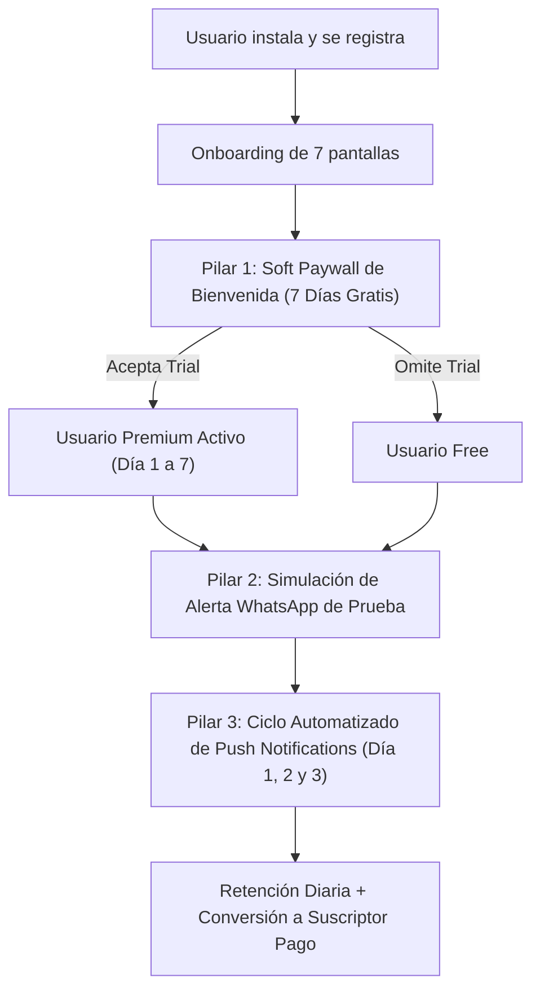

# Plan Maestro de Activación Temprana y Conversión a Premium (26 de Octubre de 2026)

**Proyecto:** Estoy Ok: Localizador Familiar  
**Fecha de Creación:** 26 de Octubre de 2026  
**Contexto:** Diagnóstico de los primeros usuarios reales adquiridos vía Meta Ads (Ernesto #42, Alfredo #43, Adriana #44) que completaron registro y Onboarding con token FCM de Android activo, pero no activaron la prueba de 7 días ni realizaron su primer check-in diario.

---

## 🎯 1. Diagnóstico del Problema (Embudo Actual)

1. **Trial Pasivo y Escondido:**
   * Actualmente, la oferta de 7 días de prueba gratis de Google Play Billing solo se muestra si el usuario entra voluntariamente a la pestaña *Familia* o *Ajustes* y presiona *"Hacerme Premium"*.
   * Un usuario nuevo no explora menús profundos si no entiende el valor inicial, perdiéndose la oportunidad de activar el trial gratuito.
2. **Ausencia del "Momento Ajá" (Activación Temprana):**
   * El usuario ve un botón "Estoy OK", pero al no tener cargado un contacto de emergencia, no experimenta la tranquilidad ni la sensación de protección real.
3. **Falta de Reenganche (Lifecycle / Nutrición Push):**
   * Si el usuario cierra la aplicación, esta se mantiene en silencio sin guiarlo en sus primeras 24 a 72 horas.

---

## 🚀 2. Estrategia en 3 Pilares para Activación y Monetización

---

## 🛡️ Pilar 1: Soft Paywall Post-Onboarding (Android Nativo)
* **Objetivo:** Multiplicar por 4 la tasa de activación de la prueba de 7 días de Google Play Store.
* **Dónde se ubica:** Inmediatamente después de que el usuario finaliza el Onboarding de bienvenida y concede los permisos de ubicación/notificaciones.
* **Diseño y Microcopy:**
  * **Título:** *"Te damos la bienvenida a Estoy Ok"*
  * **Subtítulo:** *"Disfrutá de 7 días gratis de protección completa para vos y tu familia."*
  * **Beneficios destacados:**
    * ✅ Alertas automáticas por WhatsApp a tus contactos si no confirmás tu bienestar.
    * ✅ SOS de Bolsillo (4 toques del botón de encendido con audio ambiental de 15s).
    * ✅ Detección de colisiones vehiculares por Fuerza G y rastreo en tiempo real.
  * **Botón Principal (CTA):** `"Comenzar prueba gratis de 7 días"` (Invoca el flujo oficial de Google Play Billing 8.0: *$0.00 hoy, luego $4.99/mes, cancelable en cualquier momento desde Play Store con 1 clic*).
  * **Botón Secundario (No bloqueante):** `"Continuar con la versión básica gratuita"` (Permite al usuario ingresar libremente al mapa y panel).
* **Impacto esperado:** Entre un 15% y un 25% de los usuarios nuevos inician la prueba de 7 días de Google Play.

---

## 📲 Pilar 2: Notificaciones Push Automatizadas de Activación (Backend Laravel - Sin Recompilar App)
* **Objetivo:** Recuperar a los usuarios que instalaron la app pero no interactuaron en sus primeras horas.
* **Implementación:** Comando programado en Laravel Scheduler (`checkins:send-activation-nudge`) ejecutado periódicamente por el backend en Railway.

### Secuencia de Mensajes Programados:

| Momento | Condición | Mensaje Push | Acción al Tocar |
| :--- | :--- | :--- | :--- |
| **+6 Horas** | Usuario registrado sin ningún `check-in` | *"👋 ¡Hola [Nombre]! Tu botón Estoy OK está listo. Tocalo para confirmar tu bienestar y probar tu escudo diario."* | Abre la pantalla del botón verde central (`PanelScreen`). |
| **+24 Horas** | Usuario sin contacto de emergencia cargado | *"🛡️ [Nombre], ¿quién recibiría tu aviso si te pasa algo? Agregá a tu contacto de confianza para enviar alertas por WhatsApp."* | Abre la pantalla de carga de contactos de emergencia. |
| **+48 Horas** | Usuario con contacto pero sin prueba Premium | *"⚡ ¿Sabías que podés probar Estoy Ok Premium gratis por 7 días? Activá el envío de WhatsApp automático y detección de choques."* | Abre la pantalla de suscripción de Google Play. |
| **+72 Horas** | Usuario inactivo hace más de 48 hs | *"💚 Un solo toque al día mantiene la tranquilidad de tu familia. Ingresá y dejá tu reporte de hoy."* | Abre la app directamente. |

---

## ⚡ Pilar 3: El "Efecto WhatsApp" (Envío de Mensaje de Prueba)
* **Objetivo:** Generar el "Momento Ajá" en los primeros 3 minutos de uso.
* **Mecánica:**
  * En la pantalla principal o al agregar el primer contacto de emergencia, mostrar una tarjeta destacada:
    > *"🧪 Probar cómo funciona: Tocá acá para enviar un WhatsApp de prueba a tu contacto."*
  * Al presionarlo, el backend dispara a través de Evolution API un WhatsApp oficial al contacto:
    > *"👋 Hola [Contacto], [Nombre] te acaba de agregar como su contacto de seguridad en Estoy Ok. Si un día no confirma su bienestar o activa el SOS de emergencia, te avisaremos automáticamente por acá con su ubicación."*
* **Resultado:** El contacto responde sorprendido por WhatsApp, le comenta al usuario que le llegó el mensaje, y ambos quedan convencidos de la utilidad inmediata de la app.

---

## 📋 Hoja de Ruta de Implementación

1. **Fase Inmediata (Backend Laravel - 0 Riesgo, Sin actualización en Google Play):**
   * Crear el comando `php artisan users:send-lifecycle-nudge` en Laravel.
   * Filtrar usuarios con `created_at >= 6 hours`, `last_check_in_at IS NULL` y enviar el push FCM correspondiente a los usuarios activos (#42, #43, #44).
2. **Fase 2 (Próxima Compilación Android v16 / 1.0.9):**
   * Integrar la pantalla de Soft Paywall (Prueba de 7 días gratis) tras el Onboarding.
   * Agregar el botón de *"Enviar WhatsApp de prueba al contacto"*.
